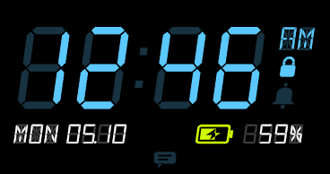
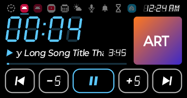
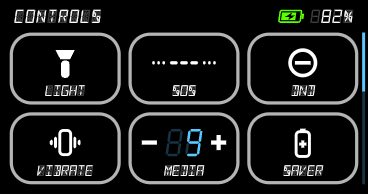
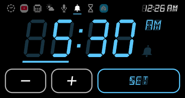
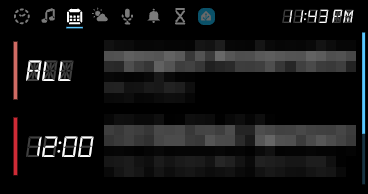
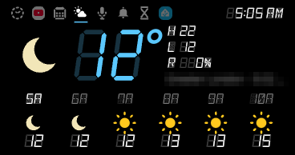

# LCD Clock for the moto razr 40

A seven-segment, LCD-style clock face and a set of pages for the **moto razr 40**'s 1.5" outside
screen (368 × 194). No root needed. It plugs into Motorola's own clock styles, then adds pages and
panels you swipe through on the outside screen with the phone closed.

<p>



</p>
<p>



</p>

Unofficial, and not made by or affiliated with Motorola. It relies on Motorola's undocumented
clock-face plugin interface, so a Motorola update could break it.

## What it does

- **Clock face "LCD Digits"**: thin seven-segment digits with the unlit segments showing faintly,
  a blinking colon, AM/PM, the weekday, date and battery, a padlock while locked, and an alarm bell.
  It comes in four colours or Motorola's custom colour.
- **Pages**: swipe left or right on the face, or tap the icons in the menu row.
  - **TIMER**: a countdown timer.
  - **ALARM**: a daily alarm with snooze. The bell blinks while snoozed.
  - **CALENDAR**: the next 7 days.
  - **WEATHER**: the forecast from Open-Meteo.
  - **RECORDER**: a voice recorder.
  - **HOME**: three Home Assistant buttons.
  - **MUSIC**: one tab per app that's playing.
- **Panels**:
  - **Notifications** (swipe up): tap one to read all of it. Contents stay hidden while the phone
    is locked.
  - **Quick controls** (swipe down): flashlight, SOS, Do Not Disturb, ring mode, media volume,
    battery saver, Night Light, Bedtime, Home Assistant buttons and a WireGuard VPN (through WG
    Tunnel).
- **Alarm and timer**: they ring on the outside screen with your choice of sound and vibration.
- **Volume-button holds**: with the phone closed, holding volume up or down opens a page of your
  choice, or toggles the flashlight.
- **Home screen widgets**: the face, or just the time.
- **Picture-in-picture**: video keeps playing when you close the phone. The razr would otherwise
  close the picture-in-picture window and stop the video.

Everything is set up in the LCD Clock app on the inside screen. Its **Setup** list shows what's
still missing.

## Install

You need:

- **A moto razr 40** (not the Ultra) with USB debugging on: Settings → System → Developer options.
  Tested on Android 15.
- **A computer with adb**, from Android's platform-tools.
- **The Android SDK** with platform 35 and build-tools. build-tools 37.0.0 is preferred; the
  newest installed is used otherwise.
- **A JDK 17 or newer**, and **zip**.

Connect the phone and run:

```sh
./install.sh
```

It builds the APK, installs it and grants the permissions adb can grant: microphone, calendar,
location, notifications, audio files, and secure settings for the saver and Night Light controls.

Then it opens the screens for the switches Android leaves to you, and waits while you turn each on:

1. **Accessibility**: turn on "LCD Clock cover button". This lets the outside screen open the pages
   and makes the volume holds work.
2. **Notification access**: allow "LCD Clock music page". This is for the MUSIC tabs and the
   notifications panel.
3. **Clock styles**: pick **LCD Digits**. Motorola keeps this choice to itself, so it can't be set
   from adb.

Run `./install.sh` again to update. It skips whatever is already set up. If you have more than one
device connected, choose one with `ANDROID_SERIAL=<serial> ./install.sh`.

The first build creates `debug.keystore`. **Keep it**: updates have to be signed with the same key,
and installing over a differently signed copy means uninstalling first, which loses the app's
settings. The keystore isn't committed, so back it up yourself.

## Optional setup, in the app

- **Home Assistant**: enter your server address and a long-lived access token (Home Assistant → your
  profile → Security). The HOME icons then show whether their entities are on, and switch them
  together. Buttons can also tap Home Assistant's own Button widgets instead.
- **VPN tile**: needs [WG Tunnel](https://github.com/zaneschepke/wgtunnel) with its remote control
  turned on. Enter its key and the tunnel name in the app.
- **Per page**: show or hide each page, change the tab order, and set how long the outside screen
  stays on. Also on the cards: the alarm's snooze length and the ring sounds.

## Privacy

Everything stays on the phone, except:

- **Weather**: approximate location goes to [Open-Meteo](https://open-meteo.com/), and Android's
  geocoder looks up the place name.
- **Home Assistant**: requests go to the server you enter. The token is kept in the app's encrypted
  storage and never logged.

## Building only

```sh
./build.sh            # builds lcd-clock.apk (no Gradle: aapt2, javac, d8, zipalign, apksigner)
./build.sh install    # builds, then runs ./install.sh
```

The SDK is looked for at `$ANDROID_HOME`, then `~/Android/Sdk`, then `~/Library/Android/sdk`.

## How it works

- **Clock face**: `LcdClockService` and `LcdSessionService` implement Motorola's clock-face plugin
  services. Motorola's clock app binds them and shows the face through a `SurfaceControlViewHost`.
  `LcdOptionsProvider` supplies the colour options to Motorola's picker. The interface classes
  those calls carry are recreated in `src/com/motorola/clockface/sdk/`.
- **Outside-screen activity**: the meta-data
  `com.motorola.allow_activities_on_small_external_display` lets the app's activity run on the
  outside screen at all. `CoverActivity` hosts the pages there.
- **Starting it with the phone closed**: only an accessibility service (`ButtonService`) may start
  activities from the background, so it opens `CoverActivity` on each outside-screen wake and on
  volume holds.
- **Music and notifications**: these come through a notification listener (`MediaListener`).

## Layout

- `src/dev/lcdclock/`: the app.
  - `CoverActivity`, `CoverTabs` and `SwipeFrame` hold the pages.
  - `CoverPage` is the shared base for the calendar, weather, recorder and panel pages.
  - `LcdClockView` draws the face, and `SegmentPainter` draws the segment digits and icons.
- `src/com/motorola/clockface/sdk/`: Motorola's plugin interface classes, recreated.
- `res/`, `assets/fonts/`: resources, and the DSEG fonts.
- `test/fakeplayer/`: a silent test media player for working on the MUSIC page.

## Credits

The segment fonts are [DSEG](https://www.keshikan.net/fonts-e.html) by keshikan, under the SIL Open
Font License 1.1 (`assets/fonts/DSEG-LICENSE.txt`).
